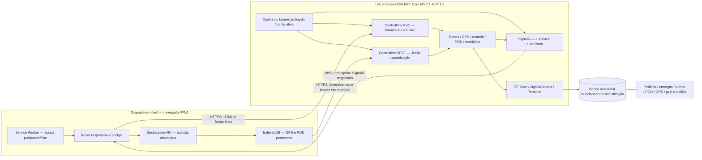
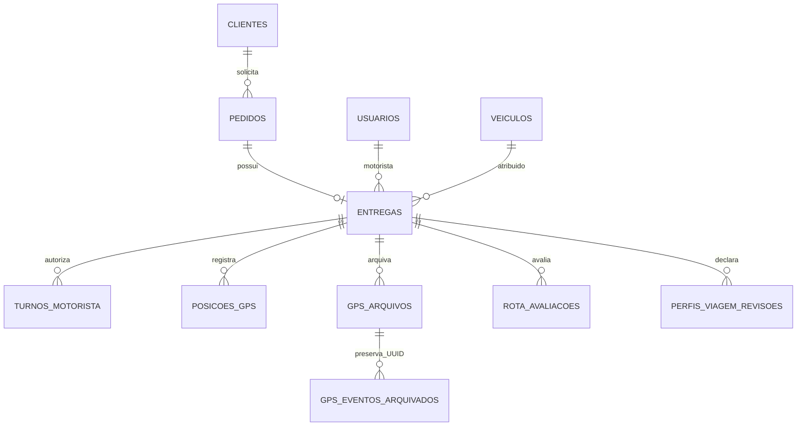

# Arquitetura mobile, API e banco — implementação real — Etapa 8A

## Escopo e transporte

O motorista utiliza páginas Razor responsivas/PWA, JavaScript, Service Worker e IndexedDB. Não foi localizado aplicativo Flutter/Dart ou APK nesta solução; não existe evidência de execução nativa Android/iOS. A arquitetura cliente-servidor foi demonstrada em processos locais e Chromium. HTTPS/WSS são o transporte exigido para uma implantação externa; os ensaios locais usam HTTP/WS em loopback, aceito pelo navegador como contexto local seguro. Isso não comprova TLS público, GPS físico ou execução em segundo plano.



O cliente móvel **não acessa SQL diretamente**. A separação em camadas é lógica, dentro do monólito MVC existente, não uma migração para microserviços. Entre os provedores, apenas um é selecionado por instância. SQL Server é referência acadêmica; SQLite sustenta desenvolvimento/testes locais e PostgreSQL possui integração local exercitada. Isso não torna os três provedores indistintamente homologados.

## Autenticação e autorização

- MVC usa cookie HttpOnly, expiração deslizante de oito horas e antiforgery nas mutações. O perfil de administrador é normalizado para `Admin`. `ActiveAccountMiddleware` revalida conta/perfil/organização/cliente; conta revogada não mantém autorização só por possuir um cookie/token antigo.
- `POST /api/auth/login` valida usuário/senha, cria cookie e retorna token bearer protegido por ASP.NET Data Protection, perfil e expiração. **Esse token não é JWT.** Não se deve decodificá-lo para inferir IDs.
- A PWA autenticada solicita `GET /Motorista/Offline/Contexto`: usuário/tenant/perfil e bearer de até cinco minutos, limitado à validade do cookie. O bearer permanece em memória; não é credencial da fila IndexedDB ou do cache Service Worker. O ID do motorista vem do contexto autenticado/HTML; IDs recebidos pela API não substituem a verificação do vínculo.
- APIs protegidas verificam bearer e autorização do recurso. `TenantId` identifica organização; `ClienteId` limita operações de um cliente dentro dela. Não são intercambiáveis. Motorista vê somente viagens atribuídas; certas mutações exigem turno autorizado, atribuição vigente e estado operacional compatível. Cliente/intermediador acessa apenas operações permitidas de seu cliente.
- `Hosting:RequireHttps=true` habilita redirecionamento HTTPS e cookie Secure. Cabeçalhos encaminhados só são aceitos com `ReverseProxy:Enabled=true` e IPs explícitos em `KnownProxies`, um salto e simetria. Não ativar confiança indiscriminada em qualquer proxy.

Implementação: [Program](../src/MglConnect.Web/Program.cs), [AuthController](../src/MglConnect.Web/Controllers/Api/AuthController.cs), [bearer](../src/MglConnect.Web/Services/ApiBearerAuthenticationHandler.cs), [conta ativa](../src/MglConnect.Web/Middleware/ActiveAccountMiddleware.cs), [contexto offline](../src/MglConnect.Web/Controllers/DriverOfflineController.cs), [contexto EF](../src/MglConnect.Web/Data/MglDbContext.cs).

## Contratos HTTP efetivos

| Método e caminho | Contrato/consumidor real | Controle principal |
|---|---|---|
| POST `/Account/Login` | Formulário de login MVC | Credenciais + antiforgery |
| POST `/api/auth/login` | JSON `Login`, `Senha`; token/perfil/expiração | Credenciais de conta ativa |
| GET `/Motorista/Offline/Contexto` | Contexto renovado da PWA e bearer curto | Cookie de motorista ativo; no-store |
| GET `/api/entregas/motorista/{motoristaId}` | Viagens elegíveis do motorista | Próprio motorista ou administrador; tenant |
| GET `/api/entregas/{id}` | Detalhes autorizados | Vínculo/perfil/tenant |
| PUT `/api/entregas/{id}/status` | Transição de status | Regras operacionais, não alteração arbitrária de estado |
| POST `/Entregas/EmitirCodigoTurno` | Administração emite código temporário | Admin/tenant/CSRF |
| POST `/Entregas/IniciarTurno` | Motorista informa `entregaId`, `codigo` | Atribuição, código, validade, conflitos e CSRF |
| POST `/api/gps/sincronizar` | `eventos` com até 50 amostras; recibo por UUID | Bearer de motorista, turno/vínculo/captura/tenant |
| GET `/api/gps/historico/{entregaId}` | Histórico paginado, período e qualidade | Cookie ou bearer; escopo do perfil/cliente |
| POST `/api/entregas/{id}/pod` | Recebedor, assinatura e localidade | Motorista autorizado/admin; conteúdo idempotente |
| GET `/api/entregas/{id}/pod-pdf` | PDF do comprovante | Admin/motorista/cliente/intermediador conforme recurso |
| GET `/api/rastreio/{codigo}` | Projeção pública permitida | Código, controles de abuso e dados mínimos |
| GET `/GpsHistorico` e `/GpsHistorico/Exportar` | Consulta/CSV administrativo | Admin/tenant, volume e CSV injection |
| GET `/health/live`, `/health/ready` | Sondas mínimas de processo/conexão | Sem dados operacionais; restringir na borda externa |
| GET `/operacional/saude` | Verificação administrativa existente | Admin, no-store |

Os caminhos previstos em `PIM-agora.pdf` §4.5 não são a lista definitiva: `/api/login` difere de `/api/auth/login`, e a lista de motorista inclui o ID. O material 8B deve descrever os contratos acima e não copiar endpoints planejados como se fossem executados. A PWA combina navegação MVC com REST e SignalR; não utiliza exclusivamente REST para todos os formulários.

## Sequência real de GPS/offline

```mermaid
sequenceDiagram
  actor Driver as Motorista
  participant PWA as PWA / driver-gps.js
  participant IDB as IndexedDB / driver-gps-queue.js
  participant Ctx as Contexto offline autenticado
  participant API as GpsController
  participant Svc as GpsIngestionService
  participant DB as Banco EF Core
  participant Hub as GpsTelemetryPublisher / SignalR
  Driver->>PWA: Inicia turno com código válido e autoriza localização
  PWA->>IDB: Persiste UUID, viagem, turno, captura e amostra
  alt Sem conexão
    IDB-->>PWA: Estado pendente preservado após recarregar
  else Oportunidade de sincronizar
    PWA->>Ctx: Cookie válido / contexto atual
    Ctx-->>PWA: Identidade e bearer curto em memória
    PWA->>API: Lote de até 50 eventos + bearer
    API->>Svc: Identidade autenticada e cada evento
    Svc->>DB: Valida vínculo, captura e UUID; transação
    DB-->>Svc: Commit / recibo persistente
    Svc-->>API: Confirmado, duplicado ou rejeitado
    API->>Hub: Notifica somente consumidores autorizados
    API-->>IDB: Recibos identificados por UUID
    IDB-->>PWA: Contagens e estado confirmado/pendente/rejeitado
  end
```

A persistência precede o envio; se a resposta se perder após commit, repetir o mesmo UUID/conteúdo recupera o recibo sem duplicar. O índice permanente preserva idempotência após arquivamento. Captura e recebimento são distintos; amostra antiga não substitui posição recente. Janela configurável de sincronização tem teto atual de 168 horas, com verificação do turno e da autorização no instante pertinente. Não é autorização geral para enviar qualquer posição a uma viagem encerrada.

A fila é limitada (padrão 2.000 eventos), trata expiração/rejeição e oferece recuperação/cópia local. Sete dias de janela não significam capacidade para sete dias de amostragem contínua. Tokens expirados/revogação/troca de usuário exigem novo contexto, sem misturar organizações. Service Worker conserva assets públicos selecionados e página offline; não faz cache indiscriminado de APIs/HTML privado e não garante coleta GPS em segundo plano. A sincronização depende das oportunidades fornecidas pela página/navegador/conexão.

[Ingestão](../src/MglConnect.Web/Services/GpsIngestionService.cs), [contratos](../src/MglConnect.Web/Services/GpsContracts.cs), [fila](../src/MglConnect.Web/wwwroot/js/driver-gps-queue.js), [captura](../src/MglConnect.Web/wwwroot/js/driver-gps.js), [Service Worker](../src/MglConnect.Web/wwwroot/sw.js).

## Turno, POD e visibilidade final

```mermaid
sequenceDiagram
  participant Admin as Administração
  participant Shift as DriverShiftService
  participant Driver as Motorista / cockpit
  participant API as MVC + API POD
  participant Track as TrackingService
  participant DB as Banco relacional
  participant Client as Cliente autorizado
  Admin->>Shift: Emite código da atribuição atual
  Driver->>Shift: Código + entrega; identidade autenticada
  Shift->>DB: Valida / inicia turno sem duplicar
  Driver->>API: Assinatura e recebedor; fila POD persistente
  API->>Track: Valida atribuição, estado e conteúdo
  Track->>DB: Conclui entrega/pedido/turno e grava comprovante
  DB-->>API: Operação confirmada
  API-->>Driver: Confirmação; reenvio igual é idempotente
  Client->>API: Consulta própria operação / comprovante PDF
  API->>DB: Verifica TenantId e ClienteId
  API-->>Client: Estado/PDF permitido
```

Uma resposta perdida não significa que a entrega deva ser repetida com conteúdo diferente: o POD igual é reconhecido; comprovante conflitante retorna conflito. Eventos e consultas posteriores convergem para o estado persistido. SignalR usa audiência revalidada, não um grupo público contendo informações internas. `TelemetryHub` está em `/telemetryHub`; `TrackingHub`, em `/trackingHub`, apresenta a projeção pública apropriada. Reconexão não dispensa consulta/validação do estado atual.

[Turnos](../src/MglConnect.Web/Services/DriverShiftService.cs), [POD/API](../src/MglConnect.Web/Controllers/Api/EntregasApiController.cs), [fila POD](../src/MglConnect.Web/wwwroot/js/driver-pod-queue.js), [rastreio](../src/MglConnect.Web/Services/TrackingService.cs), [audiência](../src/MglConnect.Web/Hubs/TelemetryAudience.cs).

## Persistência e evidências

Banco contém usuários, clientes, pedidos, entregas, veículos, turnos/códigos, auditoria, posições GPS, arquivos gzip e ledger de UUIDs, avaliações de rota e revisões de perfil de viagem. O gzip GPS é armazenado no banco, não depende de um novo volume externo de trilhas. POD/assinatura são persistidos na entrega; anexos externos exigem procedimento adicional de backup, conforme runbook existente. O diagrama seguinte é um recorte, não a descrição integral das 37 FKs:



SQLite/PostgreSQL foram exercitados por HTTP, EF e restauração. Os quatro testes SQL Server permanecem ignorados por ausência de instância autorizada. O modelo/script acadêmico SQL Server não é evidência de execução desse banco. Não se executa migração destrutiva; inicialização atual usa criação EF e atualizadores aditivos.

Rotas continuam com confiança explícita. Valhalla experimental permanece desativado, sem geometria/evidência suficiente para orientação homologada; containerização não muda esse critério nem desloca o marcador GPS para a rota.

Resultados e comandos verificáveis estão no [relatório 8A](./ETAPA_8A_INFRAESTRUTURA_DOCKER_NUVEM.md); a proposta externa está no [diagrama de implantação](./DIAGRAMA_IMPLANTACAO.md).
