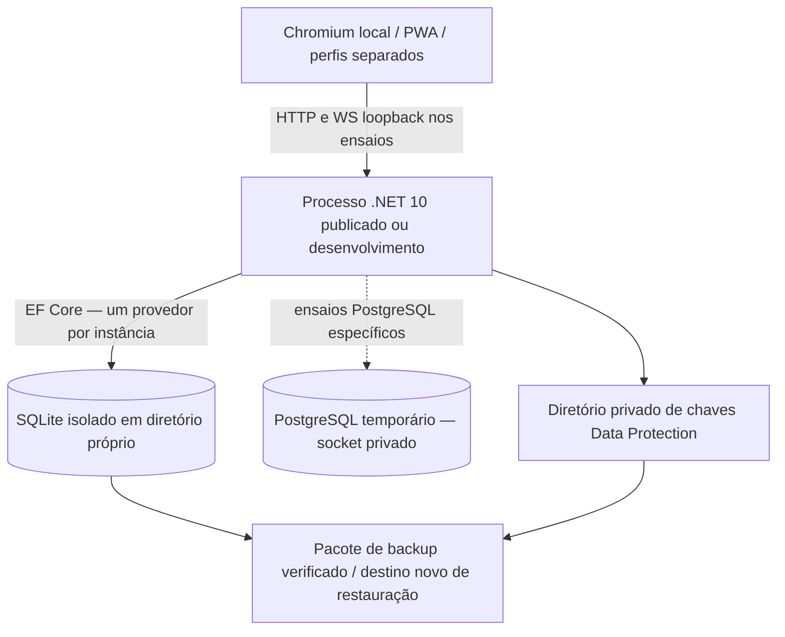
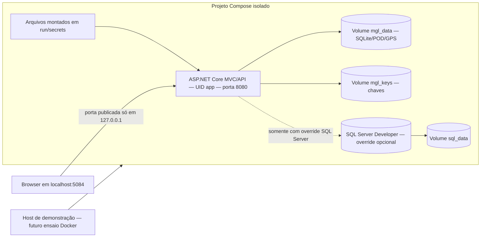
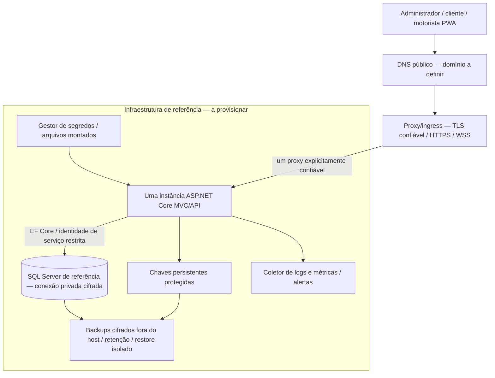

# Implantação — estado demonstrado e arquitetura de referência

## Estado efetivamente disponível

Há aplicação ASP.NET Core MVC/API/PWA executável nativamente, SQLite/PostgreSQL locais de teste, chaves persistidas, backup/restore, publicação Release testada por HTTP e configuração de containers. Não há DNS contratado, certificado público provisionado, servidor de nuvem ou deploy publicado nesta etapa. Docker não foi executado: socket sem permissão para o usuário e Compose ausente. Os diagramas distinguem os estados.

A PWA usa uma interface web no aparelho; não foi instalado APK/Flutter. Testes sintéticos de Chromium não certificam aparelhos Android/iOS nem GPS em segundo plano.

## Containers preparados — execução pendente

[Dockerfile](../Dockerfile): build SDK/runtime ASP.NET .NET 10 Noble, dependências de fontes PDF dentro da imagem, usuário sem root, porta 8080, health CLI, SIGTERM. [Compose](../docker-compose.yml): filesystem raiz somente leitura, `/tmp` efêmero, capacidades removidas, dados/chaves persistentes e credenciais sintéticas fora do repositório. O [override SQL Server](../deploy/compose.sqlserver.yml) muda o provedor, não cria dois bancos concorrentes na mesma aplicação; não publica 1433 no host. Developer/SA/TrustServerCertificate destinam-se exclusivamente ao ensaio isolado, não à produção.

A porta HTTP local não é um endpoint HTTPS público. Para testar GPS num telefone na rede, configurar TLS confiável e nome/origem apropriados; não apenas abrir a porta em `0.0.0.0`. Volumes persistentes não substituem backup. Permissões de volumes/segredos precisam ser comprovadas no Docker antes de declarar esse cenário executado.

## Nuvem proposta — ainda não provisionada

| Componente | Arquitetura proposta | Implementado/validado agora |
|---|---|---|
| Aplicação | VM Linux ou PaaS com runtime/imagem .NET 10; começar com uma instância | Processo local e pacote Release; configuração de imagem sem build Docker executado |
| Banco | SQL Server por rede privada; usuário de aplicação com mínimo privilégio; separação da conta de manutenção | Provedor e script existentes; SQL Server não executado; SQLite/PostgreSQL locais exercitados |
| HTTPS/DNS | Domínio definido pela equipe, certificado confiável, renovação e regras de acesso | Opções HTTPS/proxy e testes de confiança/cookie; nenhum DNS/certificado público criado |
| Segredos | Secret store do provedor ou arquivos montados; não build args/repositório | Leitura KeyPerFile e gerador de credenciais sintéticas testados |
| Chaves | Repositório persistente, acesso restrito e proteção em repouso por certificado/KMS/vault | Diretório persistente e restauração testados; proteção externa de chaves ainda não provisionada |
| Armazenamento | Banco/disco persistente; anexos futuros em armazenamento controlado | SQLite/gzip/POD em banco; nenhum object storage contratado |
| Backup | Backup consistente de banco e chaves, cópia cifrada fora do host, retenção e teste de recuperação | SQLite backup/verify/restore e PostgreSQL dump/restore locais; sem backup externo contratado |
| Logs/monitoramento | Coletor externo, métricas HTTP/falhas, alertas de indisponibilidade, disco, backup e fila | Correlação/diagnósticos e sondas implementados; monitoramento externo não instalado |
| Disponibilidade | Reinício supervisionado, health/readiness, manutenção e rollback; definir RPO/RTO mensuráveis | SIGTERM/reinício/recuperação em ensaios locais; sem SLA/HA externo |
| Escalabilidade | Crescimento vertical inicialmente; múltiplas instâncias somente após ensaios específicos | Caches, rate limit e audiência/estado de navegação ainda locais por instância |

A referência pode ser concretizada com VM ou PaaS compatível e banco SQL Server gerenciado/privado. A escolha comercial depende de região, licença, volume, custo e operação; nenhum fornecedor foi contratado ou homologado nesta etapa. Não se afirma equivalência de todas as características entre SQL Server e serviços compatíveis sem testes.

## Configuração de borda e operação

- `AllowedHosts` deve conter somente os nomes reais autorizados. O proxy precisa **sobrescrever** X-Forwarded-For/Proto recebidos do usuário com um par consistente, preservar upgrade WebSocket e encaminhar apenas um salto reconhecido. Não habilitar `ASPNETCORE_FORWARDEDHEADERS_ENABLED` como substituto da lista explícita.
- Configurar `ReverseProxy__Enabled=true`, `ReverseProxy__KnownProxies__0=IP_EXATO_DO_PROXY` e `Hosting__RequireHttps=true`. Não copiar um IP de exemplo como se fosse da infraestrutura real. O backend deve aceitar tráfego apenas da borda/sondas internas; TLS entre nós é necessário quando a rede/ameaça exigir.
- `/health/live` informa processo HTTP vivo; `/health/ready` verifica conexão ao banco. Nenhum dos dois certifica schema, provedor de rotas, arquivo GPS íntegro, posição recente ou saúde de todas as organizações. Restringir sondas na borda para evitar consultas públicas repetidas. `/operacional/saude` continua administrativo.
- Persistir dados e chaves. `DataProtection__KeysPath` explícito é necessário para não perder cookies/bearers em disco efêmero; a implementação também possui persistência de chaves em PostgreSQL quando configurada sem diretório. Persistência de XML não significa que ele esteja cifrado em repouso.
- SQL Server requer backup nativo e restore testado em instância separada antes de homologação. Não usar cópia casual de arquivo aberto de banco/volume como backup. Para SQLite usar o [procedimento existente](./OPERACAO_BACKUP_RESTAURACAO.md), coordenando chaves e anexos externos; restaurar somente em destino novo e reconciliar revogações posteriores ao snapshot.
- Chaves/tokens/logs, dumps e coordenadas não devem ser publicados como artefatos de CI. Logs estruturados atuais não são uma instalação de Prometheus/Grafana ou serviço de observabilidade.
- Antes de múltiplas instâncias: compartilhar/proteger chaves, definir distribuição do SignalR, estado/rate limit/cache, inicialização de schema e política de arquivos. Não habilitar autoscaling para esconder essas dependências.
- SIGTERM inicia encerramento do host (janela configurada de 20 s; Compose aguarda 30 s). Uma operação cujo cliente perdeu resposta continua sujeita à idempotência/reconciliação; SIGTERM não garante conclusão de qualquer requisição sem limite de tempo.

## Pipeline preparado

[CI](../.github/workflows/ci.yml) define checkout com permissões de leitura, SDK .NET 10, Node, build/testes, PostgreSQL temporário nativo, verificação estática, configuração Compose e ensaio de imagem/readiness em runner isolado. Ações oficiais estão fixadas por SHA. Não possui etapa de push de imagem ou deploy. **O workflow não foi enviado nem executado no GitHub.** Os comandos locais equivalentes foram executados com evidências descritas no [relatório 8A](./ETAPA_8A_INFRAESTRUTURA_DOCKER_NUVEM.md). CI remota e CD em nuvem não podem ser declaradas atendidas como execução.
