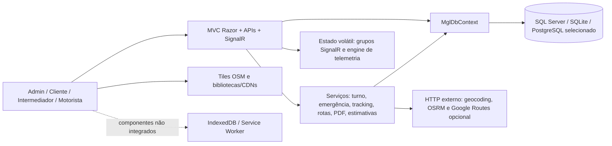

# Fase 2 — Arquitetura operacional e alvo SaaS B2B

Levantamento: 27/10/2026; consolidação: 28/10/2026. **Documento concluído para revisão humana: diagnóstico e proposta, não implementação.** A instrução final determinou executar somente a Fase 2; a auditoria corretiva da Fase 1B permanece não executada. Complementos: [inventário](./FASE_2_INVENTARIO_FUNCIONAL.md), [APIs/integrações](./FASE_2_MAPA_APIS_E_INTEGRACOES.md) e [backlog](./FASE_2_BACKLOG_PRIORIZADO.md).

## 1. Restrições e decisões vigentes

- SaaS B2B de gestão logística; administração, cliente/intermediador e motorista acessam a mesma aplicação pela internet, com permissões distintas.
- ASP.NET Core MVC/Razor em **.NET 10**, executável diretamente no notebook Kali durante desenvolvimento. Docker não pode ser requisito para executar, compilar ou publicar. Não é proposto microserviço, Kubernetes ou troca de frontend.
- **SQL Server é o banco de referência decidido pelo usuário**; SQLite continua útil ao desenvolvimento e à regressão relacional. A configuração PostgreSQL existente deve ser preservada sem chamar sua integração de homologada.
- Produção precisa ser hospedada fora do notebook, com HTTPS, domínio, persistência, supervisão do processo e restauração de backup. Desligar o notebook não pode encerrar a aplicação publicada.
- Offline do motorista é requisito essencial do MVP atual. Uma demonstração explicitamente online pode anteceder o MVP, mas não pode ser apresentada como cumprimento do offline.
- Respeitar as correções e limites da [Fase 1A](./FASE_1A_INTEGRIDADE_DADOS_SQLSERVER.md): não reaplicar backfill recorrente, não apagar órfãos para instalar FKs, não sanear dados legados sem prévia/aprovação.

O [PDF acadêmico](../PIM-agora.pdf), especialmente seções 2.5 e 5.3–5.7, previa Flutter, ausência de portal do cliente e offline fora da primeira versão. Essas intenções históricas divergem do produto atual e da diretriz mais recente. Não se transforma Flutter em dependência para entregar o MVP web/PWA sem decisão humana.

## 2. Arquitetura real, não idealizada

[Program](../src/MglConnect.Web/Program.cs) configura um único processo web: MVC/Razor, controllers REST, autenticação cookie/bearer, middleware de conta ativa, Swagger, dois hubs SignalR, serviços e um [DbContext](../src/MglConnect.Web/Data/MglDbContext.cs). Os controllers ainda executam consultas e parte das regras de negócio diretamente. Interfaces de serviço existem, mas não há projetos/camadas separados por domínio nem barramento/outbox.



Importante: o navegador consome tiles e bibliotecas; o servidor consulta geocodificação/rotas/trânsito. Leaflet não fornece ruas, trânsito ou homologação de caminhão por si só. O traço pontilhado de offline não representa uma sincronização existente.

### O que persiste e o que não persiste

| Estado | Hoje | Consequência |
|---|---|---|
| Cliente, usuário, pedido, entrega, POD e checkpoints | Banco relacional | Persiste conforme armazenamento/backup do banco |
| Código temporário, turno, alerta e auditoria | Banco; índices, versões e transações em fluxos específicos | Não depende de memória do navegador para confirmação online |
| Assinatura POD | Base64 na entrega; PDF montado sob demanda | Não há storage externo/documental versionado nem fila offline integrada |
| Rota ativa, última posição e contadores de desvio | [RouteDeviationEngine](../src/MglConnect.Web/Services/RouteDeviationEngine.cs), singleton/processo | Reinício perde estado; duas instâncias não compartilham a mesma visão |
| Grupos e emissão SignalR | Processo atual, sem backplane configurado | Não equivale a mensagem durável nem atualização garantida após desconexão |
| Custos, consumo e ESG | Cálculo com parâmetros/tabelas no código | Não são medição real, faturamento integrado ou inventário certificado |
| Chaves Data Protection | Diretório explícito ou DbContext somente no caminho PostgreSQL; senão default do host | Precisam de persistência e política de acesso no host definitivo |

## 3. Monólito modular proposto

Manter **um artefato implantável, um processo e um banco inicialmente**. Introduzir limites lógicos ao tocar cada fluxo por necessidade, não mover todos os arquivos de uma vez.

| Módulo alvo | Responsabilidade | Código atual de partida | Contrato/limite proposto |
|---|---|---|---|
| Identidade e acesso | Login, conta ativa, perfil, sessão e autorização de recurso | [Account](../src/MglConnect.Web/Controllers/AccountController.cs), [Auth API](../src/MglConnect.Web/Controllers/Api/AuthController.cs), [bearer](../src/MglConnect.Web/Services/ApiBearerAuthenticationHandler.cs), [middleware](../src/MglConnect.Web/Middleware/ActiveAccountMiddleware.cs) | Resolver identidade/organização no servidor; não confiar em IDs/roles enviados pelo cliente |
| Organizações e relacionamento | Organização contratante, clientes e vínculo de representantes | [Empresa](../src/MglConnect.Web/Models/Empresa.cs), [Cliente](../src/MglConnect.Web/Models/Cliente.cs), [Usuario](../src/MglConnect.Web/Models/Usuario.cs), [portal](../src/MglConnect.Web/Controllers/ClientePortalController.cs) | Cliente comercial não é automaticamente o tenant; delegação multicliente é decisão futura |
| Pedidos e despacho | Solicitação, transições, reserva de motorista/veículo e reassociação | [Pedidos](../src/MglConnect.Web/Controllers/PedidosController.cs), [Entregas](../src/MglConnect.Web/Controllers/EntregasController.cs) | Um caso de uso por operação; compartilhar regra entre MVC/API, mantendo transação e unicidade |
| Execução e segurança operacional | Código, início/fim de turno e emergência | [DriverShiftService](../src/MglConnect.Web/Services/DriverShiftService.cs), [EmergencyAlertService](../src/MglConnect.Web/Services/EmergencyAlertService.cs) | Confirmar somente após persistência; códigos nunca substituem login; emergência sem rede nunca significa recebida |
| Rastreamento e navegação | Checkpoints, posição, desvio, projeção para telas | [TrackingService](../src/MglConnect.Web/Services/TrackingService.cs), [hubs](../src/MglConnect.Web/Hubs), [engine](../src/MglConnect.Web/Services/RouteDeviationEngine.cs) | Separar dado persistido, amostra volátil e simulação; aplicar autorização antes de assinar/publicar |
| Documentos e conclusão | POD, assinatura, conclusão e download PDF | [TrackingService](../src/MglConnect.Web/Services/TrackingService.cs), [PodPdfService](../src/MglConnect.Web/Services/PodPdfService.cs) | Conclusão transacional e idempotente; PDF não deve ser buscado publicamente só por ID |
| Provedores e estimativas | Geocoding, rotas, trânsito, combustível, frete e ESG | [TruckRoutingService](../src/MglConnect.Web/Services/TruckRoutingService.cs), [TrafficMatchService](../src/MglConnect.Web/Services/TrafficMatchService.cs), [FuelCostService](../src/MglConnect.Web/Services/FuelCostService.cs), [AnttFreteService](../src/MglConnect.Web/Services/AnttFreteService.cs), [Co2EsgService](../src/MglConnect.Web/Services/Co2EsgService.cs) | Adaptadores substituíveis e resultado com fonte/limitação; estimativas não representam telemetria financeira real |
| Plataforma transversal | Configuração, persistência, auditoria, publicação e observabilidade | [Data](../src/MglConnect.Web/Data), [Program](../src/MglConnect.Web/Program.cs) | Sem credenciais/paths de notebook no domínio; evolução do schema explícita e testada por provedor |

### Regras de dependência

1. Razor/controllers/hubs são entradas e saídas; validam HTTP/identidade e chamam casos de uso. Não duplicar transições em cada transporte.
2. Casos de uso usam entidades/regras e portas já úteis, sem novo repositório genérico para embrulhar EF apenas por padrão arquitetural.
3. Adaptadores EF/HTTP/PDF implementam detalhes; política de entrega não deve depender de URL OSRM, Docker ou hostname local.
4. Manter os índices, versões e transações existentes ao extrair regras. Evitar dividir uma única confirmação em múltiplos commits inadvertidos.
5. Usar transação local para alterações que devem ser atômicas. Notificação SignalR ocorre depois do commit e pode falhar; se entrega garantida se tornar requisito, avaliar registro transacional de saída/reprocessamento. Não introduzir outbox ou broker sem cenário e teste que os justifiquem.
6. Começar por pastas e serviços internos no projeto existente. Separar assemblies somente se isso trouxer uma barreira verificável; não há obrigação de criar oito projetos.

## 4. Isolamento B2B: análise antes de migrar

Hoje, [MglDbContext](../src/MglConnect.Web/Data/MglDbContext.cs) filtra entidades por `TenantId` quando o contexto está vinculado a uma identidade; `Guid.Empty` continua sendo fallback. Sem contexto autenticado, consultas podem ser globais. O [portal](../src/MglConnect.Web/Controllers/ClientePortalController.cs) também resolve o único `Usuario.ClienteId`. As FKs da Fase 1A são por identificador, não por par tenant/ID.

Assim, **cliente A/B e organização A/B são eixos diferentes**. Usuários de dois clientes na mesma transportadora devem ser separados pelo vínculo comercial; administradores de duas transportadoras não podem compartilhar dados só por terem o papel Admin. Não converter todos os clientes em empresas/tenants automaticamente.

Decisões propostas, ainda não implementadas:

- Identificar a organização operadora de cada registro/usuário; inventariar todos os `Guid.Empty`, contas demonstrativas e referências cruzadas antes de qualquer alteração de coluna/FK.
- Definir se um usuário poderá pertencer a uma ou a várias organizações. A forma atual representa um tenant e um cliente por usuário; não suporta automaticamente memberships, troca de organização ou delegações multicliente.
- Definir a semântica de Intermediador: manter vínculo único no MVP ou aprovar delegações explícitas. Não liberar todos os pedidos de um tenant como atalho.
- Tornar explícita a consulta pública por capacidade de rastreio e projeção mínima. Não desligar filtros globalmente para resolver uma página pública.
- Validar relações tenant/cliente/pedido/entrega/motorista/veículo na aplicação e planejar constraints compostas ou alternativa somente depois de avaliar dados e chaves existentes.
- Fazer migração em banco clonado, com prévia, contagem, reversão e testes negativos entre organizações. A [Fase 1B pendente](./FASE_2_BACKLOG_PRIORIZADO.md) deve investigar os caminhos atuais antes de aprovar esse desenho.

## 5. Fronteiras transacionais e falhas parciais

| Fluxo | Proteção observada | Falha parcial que o desenho precisa considerar |
|---|---|---|
| Pedido do portal | Chave de envio e índice único; cliente resolvido no servidor | Chave duplicada não deve redirecionar para recurso de outro cliente; teste cruzado necessário |
| Despacho | Transação serializável, pedido sem entrega, índices de reserva e versão | Disponibilidade validada antes do save ainda pode conflitar; responder sem gravar meia entrega |
| Troca de atribuição | Invalida código, incrementa versão, bloqueia turno ativo | [CancelCodeAsync](../src/MglConnect.Web/Services/DriverShiftService.cs) salva antes do save final do controller; revisar se falha posterior deixa código cancelado sem alteração concluída |
| Início de turno | Código vinculado, tentativas/validade, transação e índices filtrados | Concorrência entre processos e provedores não é comprovada só por teste InMemory; SQLite tem cenário concorrente, SQL Server ainda exige cenário dedicado |
| Emergência | Chave idempotente; alerta e auditoria persistidos antes de sucesso | Confirmação no dispositivo não significa operador reconheceu; não existe canal externo de socorro |
| POD | Entrega/pedido/turno/checkpoint/auditoria no mesmo save; notificação posterior | Resposta perdida após commit requer reconsulta/reenvio idempotente. Assinatura ainda não tem fila persistente no navegador |
| Telemetria | Autorização, validação GPS e filtros de ruído | Desconexão/restart perde estado contínuo; sucesso de invoke não é histórico GPS durável |
| Startup | Atualização operacional transacional | `EnsureCreated` e outros atualizadores ficam fora dessa transação; não é migration global atômica |

Os itens da coluna final são cenários para testes e investigação, não declaração de exploração reproduzida nesta Fase 2.

## 6. Fundação offline proposta, não existente

O [mapa de integrações](./FASE_2_MAPA_APIS_E_INTEGRACOES.md) descreve o estado atual desconectado. A proposta mantém servidor como autoridade operacional:

```text
captura local → gravação durável no dispositivo → pendente → envio com ID estável
                    ↑ falha de rede/HTTP: manter item       ↓
               retry limitado / conflito ← resposta validada do servidor
                                                    ↓
                                    confirmado, com recibo/cursor de sync
```

Antes de implementar, definir armazenamento único/versionado, identidade/tenant vinculados ao item, estados da UI, limite de dados, expiração de sessão, política de logout/troca de conta, conflitos e retenção. Não guardar tokens, assinaturas e dados pessoais indiscriminadamente.

- GPS primeiro, com amostragem e política de perda explicitamente aprovada; diferenciar capturado no aparelho de recebido pela operação.
- POD depois de existir idempotência/recibo de confirmação no servidor, preservando assinatura antes de informar salvamento local.
- Emergência exige desenho de contingência desde o início. Um alerta na fila local **não foi recebido pela operação**; informar falha/pendência e orientar contato telefônico.
- Background Sync é mecanismo auxiliar, de suporte limitado e contexto seguro, não garantia de execução ao fechar o navegador. Exige registro da tarefa além do listener [referências MDN](./FASE_2_MAPA_APIS_E_INTEGRACOES.md).
- GPS contínuo com aplicativo fechado não é consequência automática de instalar a PWA. Se isso for requisito real, testar limitações de SO/navegador e decidir solução dedicada, sem prometer uma capacidade inexistente.

## 7. Local e produção sem dependência obrigatória de Docker

### Desenvolvimento comprovado

SDK local `.NET 10.0.403`; runtime `10.0.14` no registro anterior. Na retomada de 28/10: restore exit 0, build exit 0 com 0 warnings/0 errors e testes exit 0 com **98 aprovados, 0 falhos e 4 ignorados**. Conexão SQL Server retirada somente do ambiente filho; os testes externos não foram executados. Comandos e limites constam no [encerramento do inventário](./FASE_2_INVENTARIO_FUNCIONAL.md#13-encerramento-reproduzível-da-fase-2--28102026). Nenhum controller/serviço usa a API Docker para operar.

Exemplo de execução a validar pelo desenvolvedor, não realizado novamente nesta fase contra o banco local existente:

```bash
export DOTNET_ROOT=$HOME/.local/share/mglconnect-dotnet10
"$DOTNET_ROOT/dotnet" restore MglConnect.sln
"$DOTNET_ROOT/dotnet" build MglConnect.sln --no-restore
"$DOTNET_ROOT/dotnet" test --no-restore
# --no-launch-profile evita perfil que força Development e portas 5284/7299.
"$DOTNET_ROOT/dotnet" run --no-launch-profile --project src/MglConnect.Web
```

Selecionar conexão/provedor e seed por configuração de processo. Não reaproveitar configuração de produção para fazer smoke local. SQLite é alternativa auxiliar de execução, **não substituto silencioso da validação SQL Server**.

### Publicação proposta

```text
Internet / domínio HTTPS
        ↓
proxy confiável ou plataforma com TLS e WebSockets
        ↓
processo ASP.NET Core .NET 10 supervisionado, uma instância inicialmente
        ├─ SQL Server persistente em ambiente autorizado/licenciado
        ├─ chaves Data Protection persistentes e protegidas
        └─ provedores externos contratados/configurados + logs minimizados
```

A Microsoft documenta publicação direta .NET em Linux com proxy e supervisão por serviço, sem exigir container ([guia oficial](https://learn.microsoft.com/en-us/aspnet/core/host-and-deploy/linux-nginx?view=aspnetcore-10.0), consultado em 27/10/2026). Isso fundamenta a viabilidade da proposta; não comprova que essa implantação já exista.

Proposta de empacotamento futuro: `dotnet publish src/MglConnect.Web/MglConnect.Web.csproj -c Release -o <diretório-isolado>`, testar DLL em host Linux compatível, configurar serviço gerenciado e só então publicar. **Publish/deploy não executados nesta fase.**

### Pendências concretas de implantação

1. [Program](../src/MglConnect.Web/Program.cs) não configura explicitamente forwarded headers/proxies confiáveis nem redirecionamento HTTPS; HSTS isolado não fornece certificado, domínio ou proxy. Validar esquema HTTPS/cookies/URLs por trás do host escolhido.
2. Connection string SQL Server obrigatória no ambiente: o fallback é SQLite. URLs PostgreSQL ambientais têm precedência; verificar configuração efetiva sem imprimir valores.
3. Persistência de chaves não pode depender de filesystem efêmero ou path do notebook. API bearer e cookies usam Data Protection; testar restart/recuperação.
4. Conta operacional inicial não possui onboarding web dedicado. Seed demonstrativo não é estratégia de provisionamento comercial; manter `DemoData__Enabled=false` em produção normal.
5. Photon/OSRM demos configuradas em Development não significam roteamento disponível em Production. Tiles estão em URLs das views; externalizar/contratar é tarefa futura, não capacidade de configuração completa já entregue.
6. PDF depende de QuestPDF e assets nativos Skia/HarfBuzz; testar geração/download no destino Linux e verificar licença aplicável. Build/startup não validam renderização de PDF.
7. Grupos SignalR e engine locais exigem uma instância inicialmente ou coordenação aprovada antes de escalar. Não adicionar backplane sem justificar também o estado de telemetria.
8. Health/readiness, backup/restauração, retenção, alertas de falha, CI e procedimento de rollback não foram identificados como entregas completas.
9. A imagem Developer usada nos testes não é licença de produção SQL Server ([Microsoft](https://learn.microsoft.com/en-us/sql/sql-server/editions-and-components-of-sql-server-2022), consultado em 27/10/2026). Escolher modalidade/limites/custo de produção separadamente.

10. Rever o cache de geocodificação por sete dias e a combinação de resultados Google com Leaflet/Esri/OSM perante o contrato aplicável. As [referências e limitações consultadas](./FASE_2_MAPA_APIS_E_INTEGRACOES.md#14-referências-externas-consultadas-e-limites-comerciais) não constituem aprovação de uso comercial. Esri/CDNs, FluentAssertions e demais dependências exigem revisão própria, sem contratação nesta fase.

Não há bloqueio de código que obrigue Docker para desenvolvimento/publicação. Há lacunas de configuração e operação. O [Dockerfile](../Dockerfile) e o [Compose](../docker-compose.yml) são caminhos opcionais existentes, não arquitetura obrigatória.

## 8. Evolução incremental e gates

| Gate | Resultado verificável | Dependências |
|---|---|---|
| G0 — preservar baseline | Regressões verdes, versão de SDK e dados/alterações locais preservados | Situação da Fase 1A e verificação atual |
| G1 — segurança de exposição | Fase 1B autorizada/executada; matriz negativa/positiva de HTTP, hubs, POD e cliente/organização | Não realizada pela produção deste documento |
| G2 — demonstração online restrita | Aplicação remota com HTTPS, banco/chaves persistentes, dados fictícios, perfis e recuperação básica; funciona com notebook desligado | G1 + escolhas de host, domínio, edição DB e provedores |
| G3 — MVP operacional com offline | GPS/POD/emergência com estados honestos e recuperação testada, dentro do requisito aprovado | G1 + contratos de integridade/sync; não equivale à demo apenas online |
| G4 — candidato comercial | Isolamento organizacional validado, restauração ensaiada, privacidade/retenção, licenças/provedores, observabilidade e piloto supervisionado | G2/G3 + decisões de negócio/operação e testes reais |

Não foram atribuídos prazos, métricas de disponibilidade, volume de frota ou orçamento sem dados. Planos/pagamentos, multi-stop, 3D e navegação pesada homologada não são pré-requisitos automáticos desses gates. Ver [backlog com escopo e critérios](./FASE_2_BACKLOG_PRIORIZADO.md).

## 9. Decisões humanas necessárias

Qual organização cada dado atual representa? Intermediador representa um ou vários clientes? Quem cria/recupera/desativa contas? Que dados o rastreio público pode expor? Qual retenção e contingência para GPS/POD/emergência? Quem monitora alertas e em quais horários? Qual host/SQL Server/provedor de mapas cabe no orçamento? Flutter ainda é exigência acadêmica ou a interface mobile web é suficiente? Qual região/frota e validação operacional seriam necessárias para uso rodoviário?

Nenhuma resposta foi presumida como autorização de migração, compra, deploy ou nova funcionalidade. A implementação desta arquitetura depende de aprovação posterior.

## 10. Consistência e conclusão documental

Os quatro relatórios distinguem estado atual, evidência de teste e proposta. O [inventário](./FASE_2_INVENTARIO_FUNCIONAL.md) delimita sete estados e 17 FKs; o [mapa](./FASE_2_MAPA_APIS_E_INTEGRACOES.md) discrimina 54 ações/56 combinações, provedores e offline; o [backlog](./FASE_2_BACKLOG_PRIORIZADO.md) mantém critérios/dependências sem iniciar os itens. As classificações não são gates operacionais aprovados: a documentação está concluída, enquanto segurança corretiva, offline funcional, piloto e produção permanecem pendentes.

O registro de testes SQL Server com 102 aprovados pertence à Fase 1A histórica, não à retomada atual. Não houve código funcional, configuração, infraestrutura ou dado alterado; nenhum commit/push/deploy ou Fase 1B. O [marcador de fechamento](./FASE_2_INVENTARIO_FUNCIONAL.md#13-encerramento-reproduzível-da-fase-2--28102026) orienta execuções posteriores a verificar conclusão e mudanças antes de repetir trabalho. Aguardar revisão humana.
