# Fase 2 — Backlog priorizado e caminho crítico

Levantamento: 27/10/2026; consolidação: 28/10/2026. **Documento concluído para revisão humana; planejamento sem execução dos itens abaixo.** A solicitação determinou executar exclusivamente a Fase 2. A Fase 1B corretiva não foi executada nem declarada aprovada.

Base: [Fase 0](./ETAPA_1_DIAGNOSTICO_BASE_TECNICA.md), [Fase 1A](./FASE_1A_INTEGRIDADE_DADOS_SQLSERVER.md), [requisitos](../REQUISITOS_MGL_CONNECT_MOTORISTA_E_PEDIDOS.md), [inventário atual](./FASE_2_INVENTARIO_FUNCIONAL.md), [APIs/integrações](./FASE_2_MAPA_APIS_E_INTEGRACOES.md) e [arquitetura-alvo proposta](./FASE_2_ARQUITETURA_ALVO_SAAS.md). Decisões mais recentes do usuário prevalecem sobre roadmaps históricos: SQL Server de referência, .NET 10 direto, containers opcionais apenas como ferramentas de teste, SaaS B2B remoto e offline essencial ao MVP.

## 1. Priorização e níveis de compromisso

P0: impede exposição responsável/demonstração confiável. P1: necessário ao MVP/piloto operacional. P2: evolução condicionada a necessidade demonstrada. Não representam prazo ou orçamento. Um risco estático não é automaticamente uma vulnerabilidade explorada; cada correção de segurança depende de reproduzir o cenário e preservar os controles válidos.

Categorias:

- **Acadêmico:** evidência, coerência do relatório e demonstração com dados fictícios; não obriga inventar recursos.
- **Produto/MVP:** fluxo operacional confiável, perfis e offline aprovado como essencial.
- **Comercial:** isolamento organizacional, operação remota, licenças, dados reais e suporte definido.
- **Opcional:** não entra no caminho crítico sem decisão humana.

Nenhum item abaixo autoriza instalar pacotes, alterar infraestrutura, criar contas em provedores, comprar serviços, executar deploy, sanear dados antigos ou reorganizar o código automaticamente.

O [registro final de validação](./FASE_2_INVENTARIO_FUNCIONAL.md#13-encerramento-reproduzível-da-fase-2--28102026) contém a execução de 28/10: restore/build aprovados, zero warnings/errors, 98 testes aprovados, zero falhos e quatro SQL Server ignorados. Isso encerra a documentação; não encerra B01–B21. Os 102 aprovados com SQL Server da Fase 1A são históricos.

Precisão para B05/B15: rever contrato de cache/exibição do Google Geocoding, pois o código mantém coordenadas em memória por sete dias e usa mapas Leaflet/Esri/OSM. O [mapa de integrações](./FASE_2_MAPA_APIS_E_INTEGRACOES.md#12-provedores-e-contratos-de-integração--complementação-de-2810) registra dados enviados, timeouts, limites locais, referências consultadas e termos/cotas não verificados. Nenhuma compatibilidade comercial foi presumida nem serviço contratado.

## 2. Itens P0 — exposição e demonstração online

| ID / escopo | Evidência e objetivo | Arquivos/módulos prováveis | Pré-requisito/dependência | Validação e aceite objetivo | Risco de regressão |
|---|---|---|---|---|---|
| B01 — auditoria corretiva Fase 1B; produto/comercial | Controles de recurso existem, mas não há evidência de auditoria HTTP/browser completa, rate limit, limite POD e segregação organizacional integral. Reproduzir riscos antes de corrigir | [controllers](../src/MglConnect.Web/Controllers), [hubs](../src/MglConnect.Web/Hubs), [middleware](../src/MglConnect.Web/Middleware), [autenticação](../src/MglConnect.Web/Services/ApiBearerAuthenticationHandler.cs) | Autorizar Fase 1B separadamente; contas/fixtures de dois clientes, motoristas e organizações | Testes negativos/positivos via HTTP/hub de IDs trocados, sessão inválida, conta desativada, turno ausente, perfis e dados públicos; correções apenas confirmadas; regressões verdes | Bloquear perfis legítimos ou abrir exceções globais para resolver uma rota |
| B02 — superfície pública e minimização; produto/comercial | [API pública](../src/MglConnect.Web/Controllers/Api/RastreioApiController.cs), [view pública](../src/MglConnect.Web/Views/Rastreio/Index.cshtml) e [tracking público](../src/MglConnect.Web/Hubs/TrackingHub.cs) não têm a mesma projeção; código decimal de rastreio e limites de consulta precisam avaliação | [TrackingService](../src/MglConnect.Web/Services/TrackingService.cs), rastreio e consumidores | B01; decidir campos públicos e política para códigos antigos | Saber um código só permite os campos aprovados; não vazar assinatura/documentos/endereço completo sem regra expressa; testar enumeração/limites e compatibilidade dos códigos existentes | Quebrar rastreio antigo ou tornar operação/POD inacessível por mudança não migrada |
| B03 — dados existentes antes de upgrade/publicação; produto | Fase 1A corrigiu geração/backfill novo, não flags antigas, órfãos ou definição antiga de chave; updater pode bloquear base inconsistente | [Data](../src/MglConnect.Web/Data), prévia de saneamento da [Fase 1A](./FASE_1A_INTEGRIDADE_DADOS_SQLSERVER.md) | Backup/clonagem e autorização específica por banco; não tocar bancos preservados de teste automaticamente | Prévia e contagens aprovadas; teste em clone SQL Server; mesma execução repetida não duplica/reativa; falha deixa dados preservados. Correção de registros só após aprovação | Perder reservas válidas, confundir cancelamento/turno ou gerar alteração semântica silenciosa |
| B04 — configuração portátil e segurança do host; produto | [Program](../src/MglConnect.Web/Program.cs) seleciona PostgreSQL por URL prioritária, fallback SQLite; chaves SQL Server precisam estratégia; TLS/proxy não estão concluídos | Program, configuração por ambiente, [projetos](../src/MglConnect.Web/MglConnect.Web.csproj) | B01; escolher processo/host/proxy e conexão SQL Server de teste | Rodar/publish sem Docker; identificar provedor efetivo sem mostrar segredo; nenhuma URL/path pessoal obrigatório; restart preserva sessão quando esperado; Production sem seed involuntário; HTTPS/proxy confiável testados | Cookie/token inválido após restart; iniciar em banco errado por variável herdada |
| B05 — infraestrutura externa e licenças; comercial/demonstração | Container SQL Developer é só teste; mapas usam demos/CDNs; QuestPDF/FluentAssertions têm termos próprios | [mapa de dependências e fontes](./FASE_2_MAPA_APIS_E_INTEGRACOES.md), [csproj web](../src/MglConnect.Web/MglConnect.Web.csproj), [csproj testes](../src/MglConnect.Tests/MglConnect.Tests.csproj) | Decidir orçamento, modalidade DB/host e finalidade da demo; sem contratar automaticamente | Edição DB, domínio/TLS, chaves, armazenamento e limites documentados; compatibilidade de WebSockets; elegibilidade/licenças verificadas para versões usadas; quotas/contingência definidos | Supor gratuidade/SLA, usar Developer em produção ou receber dados reais em demo pública |
| B06 — regressão de jornada e operação básica; acadêmico/produto | Testes de métodos não validam binding/CSRF/renderização, PDF nativo e login/links completos em host real | [Views](../src/MglConnect.Web/Views), controllers, [PodPdfService](../src/MglConnect.Web/Services/PodPdfService.cs), testes existentes | B01–B05 no ambiente isolado | E2E login → pedido → despacho → código → turno → emergência/reconhecimento → POD → portal/rastreio; cliente B/motorista B recusados; PDF real abre; restart/restore ensaiados; nenhum falso sucesso offline | Suíte verde no teste direto, mas falha de cookie/bearer, rota, antiforgery ou biblioteca nativa em produção |
| B07 — demonstração online restrita; acadêmico/produto | Não há URL pública/host/domínio validados; notebook não pode hospedar produção dependente de sua energia | Empacotamento .NET e configuração operacional, sem exigir novo framework | B01–B06; autorização de publicação separada | URL HTTPS externa e perfis operantes com dados fictícios; persistência após reinício; teste externo com notebook desligado; acesso à demo controlado; limitações publicadas | Confundir publicação com prontidão comercial ou apresentar demo online como MVP offline concluído |

## 3. Itens P1 — MVP offline e candidato comercial

| ID / escopo | Evidência e objetivo | Arquivos/módulos prováveis | Dependências | Testes e critério de aceite | Risco/limite |
|---|---|---|---|---|---|
| B08 — contrato organizacional e migração B2B; comercial | `TenantId`/filtros existem, FKs não são compostas; `Usuario.ClienteId` único não representa delegações | [contexto](../src/MglConnect.Web/Data/MglDbContext.cs), [Empresa](../src/MglConnect.Web/Models/Empresa.cs), [Usuario](../src/MglConnect.Web/Models/Usuario.cs), portal/auth | B01; definir organização, usuário multi-org, cliente/intermediador e tratamento de `Guid.Empty` | Modelo/ADR aprovado antes de mudança; inventário de dados e clone; testes entre duas organizações e dois clientes da mesma organização; importação/reversão sem perda; provisionamento de contas definido | Converter cliente em tenant indiscriminadamente ou permitir referências cruzadas apenas porque o ID existe |
| B09 — contrato de armazenamento/sync; produto/MVP | [pwa-offline](../src/MglConnect.Web/wwwroot/js/pwa-offline.js), [worker](../src/MglConnect.Web/wwwroot/sw.js) e [tracker](../src/MglConnect.Web/wwwroot/js/tracker.js) têm contratos/stores desconectados | Navegador, DTOs/recibos de servidor e casos de uso | B01/B08 ou escopo provisório de organização explicitamente aprovado; decisão de retenção/contingência da emergência já nesta etapa | Um schema/versionamento; item ligado a usuário/organização/viagem; UI distingue dispositivo/pendente/servidor; testes de quota, corrupção, logout, troca de conta, HTTP 4xx/5xx e sessão expirada; nenhuma fila removida sem confirmação válida | Gravar em memória e informar salvamento durável; sincronizar item da conta anterior |
| B10 — GPS persistente primeiro; produto/MVP | `emitTelemetry` online e fila volátil não conectam IndexedDB; estado da engine não é histórico GPS | [tracker](../src/MglConnect.Web/wwwroot/js/tracker.js), hubs/engine, contrato B09 | B09; definir amostragem, limite/retencão e contrato de ingestão idempotente | Capturar → salvar → recarregar navegador → recuperar → reconectar; reenvio não duplica; dados sem permissão não são coletados; servidor distingue posição atual de amostra atrasada | Não prometer rastreamento em tempo real quando só há fila local; GPS com app fechado é requisito separado |
| B11 — POD offline confirmado; produto/MVP | Canvas submete online; estado concluído exige banco; reenvio/resposta perdida precisa contrato explícito | [Navegar](../src/MglConnect.Web/Views/Entregas/Navegar.cshtml), [POD web](../src/MglConnect.Web/Controllers/EntregasController.cs), [API](../src/MglConnect.Web/Controllers/Api/EntregasApiController.cs), TrackingService | B09, experiência B10 e idempotência servidor testada antes de enviar assinatura | Assinatura/metadados sobrevivem desconexão/reload/fechamento compatível; limite e tipo validados; reenvio tem mesmo ID e devolve recibo; conflito de turno/atribuição é explícito; conclusão só após commit | Perda da assinatura, duplicação de auditoria/checkpoint ou falsa conclusão local |
| B12 — emergência e contingência; produto/MVP | Persistência/idempotência online existem; UI avisa falha; não há SMS/push nem central externa | [EmergencyAlertService](../src/MglConnect.Web/Services/EmergencyAlertService.cs), [Navegar](../src/MglConnect.Web/Views/Entregas/Navegar.cshtml), alertas administrativos | Desenho operacional junto a B09; implementação posterior conforme política aprovada | Testar sem rede, rede perdida após commit, duplicação, posição ausente/stale, reconhecimento do operador e expiração; “pendente” nunca aparece como “recebido”; procedimento telefônico explícito | Uma fila local não aciona socorro. Definir quem atende e disponibilidade sem prometer 24/7 |
| B13 — consistência de eventos, conflitos e restart; produto/comercial | SignalR pós-commit pode falhar; cancelamento de código e atribuição têm saves separados; engine é singleton volátil | DriverShiftService, TrackingService, [EntregasController](../src/MglConnect.Web/Controllers/EntregasController.cs), hubs/engine | B01; reproduzir falhas antes de refatorar; testes SQL Server autorizados em bancos separados | Falha injetada entre etapas; nenhum sucesso parcial indevido; reconsulta converge; disputa de despacho/turno comprovada no SQL Server; versão e unicidade mantidas; tolerância a restart definida | Introduzir outbox/backplane como solução genérica sem necessidade, ou perder atomicidade ao extrair serviços |
| B14 — operação e validação contínua; comercial | Logs básicos existem, sem pipeline CI/health/readiness/retention completos no inventário | [solução](../MglConnect.sln), [testes](../src/MglConnect.Tests), configuração de operação e persistência | B04/B05; metas operacionais decididas com equipe | CI restore/build/test; job SQL Server explicitamente separado; testes de restauração e readiness; observabilidade sem coordenadas/assinaturas/segredos em logs; alertas e runbook exercitados | Confundir login HTTP 200 com saúde do banco/negócio, ou coletar dados pessoais demais para “monitorar” |
| B15 — validação de fornecedores e estimativas; produto/comercial | OSRM genérico, demos sem SLA; combustível/pedágio/frete/ESG com tabelas locais | [TruckRoutingService](../src/MglConnect.Web/Services/TruckRoutingService.cs), [TrafficMatchService](../src/MglConnect.Web/Services/TrafficMatchService.cs), serviços de estimativa | B05; frota/região/proposta comercial definidas | Contratos/quotas e custo por cenário calculados com volume real; dados fictícios na avaliação; fontes/atualização explícitas; avisos de não homologação mantidos; nenhuma estimativa apresentada como piso legal ou medição real validada | Contratar mapa sem cobertura/restrições exigidas ou anunciar economia/conformidade sem medição |
| B16 — coerência documental e decisão acadêmica mobile; acadêmico | PDF prevê Flutter e offline posterior; requisitos/code atuais usam interface motorista Razor e offline essencial | [PDF](../PIM-agora.pdf), [requisitos](../REQUISITOS_MGL_CONNECT_MOTORISTA_E_PEDIDOS.md), relatórios históricos | Decisão do grupo/orientação sobre entregável mobile; não reescrever histórico sem consentimento | Documentar diferenças e versão; demo e relatório descrevem somente recursos comprovados; Flutter ausente continua ausente até decisão/implementação; sem declarações fictícias de teste/cobertura | Gastar prazo reconstruindo app sem exigência atual ou declarar PWA equivalente a qualquer exigência acadêmica sem confirmação |

## 4. P2 — opcionais e condicionados

| ID | Possibilidade | Evidência de origem e estado | Condição para entrar no escopo |
|---|---|---|---|
| B17 | Homologar PostgreSQL atualizado | Provedor/parser/DDL existem, sem integração real atual; não é banco de referência escolhido | Cliente/host exigir suporte real e orçamento para regressão por provedor; não migrar SQL Server por conveniência de hospedagem |
| B18 | Desenho modular incremental | Controllers concentram fluxo e acesso EF; interfaces atuais já oferecem pontos de extração | Extrair somente o caso de uso necessário ao item aprovado; testes mantêm contratos/rotas; não separar em microserviços |
| B19 | Jornada, RH, salário, volumes/janelas/contatos adicionais | FR-03 e FR-14 dos [requisitos](../REQUISITOS_MGL_CONNECT_MOTORISTA_E_PEDIDOS.md); não estão prontos | Definir regra, fonte oficial, privacidade e necessidade; não inferir folha/jornada legal do GPS |
| B20 | Truck routing homologado, multi-stop, 3D, HMM/geofencing, GPS em background | Roadmap histórico e FR-16; não correspondem a capacidades completas atuais | Prova técnica e operacional específica, provedor/dados e critérios de segurança; não obrigatórios para demonstrar gestão de pedidos online |
| B21 | Membership/delegação avançada, planos e pagamentos | Evolução comercial possível; modelo/checkout de cobrança não identificados | Validar negócio e papéis; pagamentos não são requisito automático do monólito B2B nem desta fase |

## 5. Caminho crítico e dependências

```mermaid
flowchart TD
    A[B01 Segurança de exposição] --> P[B02 Privacidade pública]
    A --> D[B03 Prévia de dados existentes]
    A --> C[B04 Configuração portátil]
    L[B05 Host, DB, licenças e provedores] --> C
    P --> T[B06 E2E e recuperação]
    D --> T
    C --> T
    T --> DEMO[B07 Demo online restrita - não é MVP offline]
    A --> O[B08 Organização e vínculos]
    O --> S[B09 Contrato offline + desenho de emergência]
    S --> GPS[B10 GPS]
    GPS --> POD[B11 POD]
    S --> EM[B12 Emergência e contingência]
    POD --> MVP[MVP operacional com offline verificado]
    EM --> MVP
    MVP --> COM[Candidato comercial + piloto supervisionado]
    DEMO --> COM
    R[B13 Consistência + B14 Operação + B15 Fornecedores] --> COM
```

B16 é transversal à entrega acadêmica. A ordem não obriga esperar a publicação da demo para desenhar offline; obriga não usar sincronização como desculpa para deixar autorização/integridade sem validação. O desenho de emergência começa em B09, mesmo que GPS seja o primeiro fluxo offline implementado.

**Demo:** dados fictícios, acesso limitado, fluxos online declarados, processo remoto independente do notebook, persistência/HTTPS. Não anunciar offline pronto, operação rodoviária homologada nem disponibilidade comercial.

**MVP:** precisa cumprir o requisito offline aprovado e as regras de confirmação/recuperação, não apenas abrir um site.

**Candidato comercial:** além do MVP, precisa atender organização real, permissões, privacidade/retenção, licenças/provedores, backup/restore, suporte/contingência e piloto com critérios acordados. Testes verdes não substituem isso.

## 6. Gate de aprovação de cada item futuro

Antes de implementar: evidência reproduzível, escopo pequeno, arquivos afetados, regra esperada, pré-condições de dados e teste de aceite. Durante: preservar Git e dados, sem correção silenciosa de ambientes. Depois: restore/build/test, negativos/positivos e integrações pertinentes; distinguir testes unitários, SQLite, SQL Server e browser; registrar contagens exatas e bloqueios. Não encerrar item se o teste crítico foi ignorado.

Para changes de schema/dados: backup e clone, prévia/contagens, transação ou plano de interrupção segura, repetição/idempotência e autorização de saneamento. Para exposição pública: validação de HTTPS, autenticação/perfis, payload, privacidade e configuração Production.

## 7. Questões para decisão humana

1. Confirmar que a próxima execução corretiva será a Fase 1B, já que ela não foi executada por este pedido final de Fase 2.
2. Separar organização operadora de cliente contratante: quem recebe cada `TenantId` atual e como tratar registros de tenant vazio?
3. Intermediador terá um cliente ou representações múltiplas? Usuário poderá trocar de organização?
4. Qual projeção é aceitável no rastreio público? Assinatura, documento, endereço e localização exata devem permanecer restritos por padrão até decisão.
5. Quem cria contas, emite códigos e atende emergências? Quais canais e horários efetivos de atendimento?
6. Qual política de retenção local/remota, logout, perda do aparelho e conflito offline? Qual procedimento de contingência sem rede?
7. Qual orçamento e responsável por host/domínio/SQL Server/provedores/licenças? Nenhuma cotação foi inventada.
8. Flutter é uma entrega acadêmica exigida ou a interface web mobile/PWA cumpre o acordo atual? O repositório não possui app Flutter.
9. Quais dados/testes e recursos de Fase 0/1A podem ser limpos, em autorização posterior e por alvos explícitos?

**Encerramento:** esta fase entregou inventário e propostas. Nenhum item deste backlog foi iniciado automaticamente.

Para automação posterior: verificar os quatro relatórios e o marcador de conclusão no inventário antes de reescrever ou repetir testes. Sem mudança relevante de produto/evidência, registrar conclusão já existente. Esta entrega para revisão não aprova correções, publicação ou início de Fase 1B. Aguardar decisão humana sobre as questões da seção 7.
