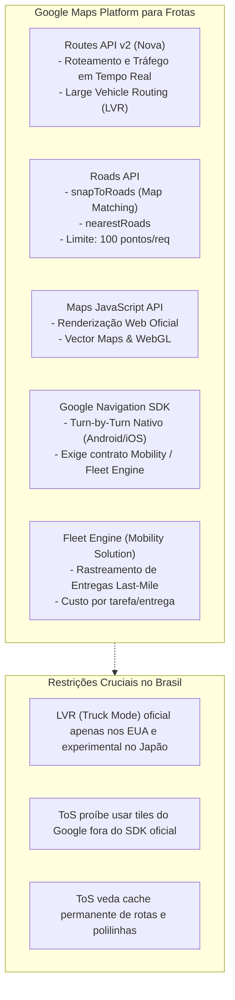
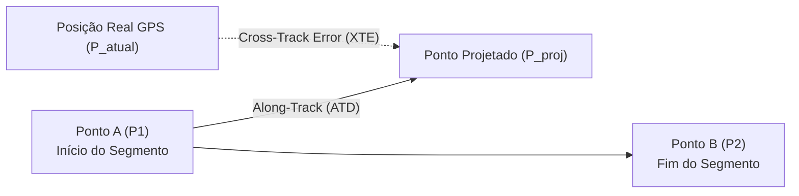
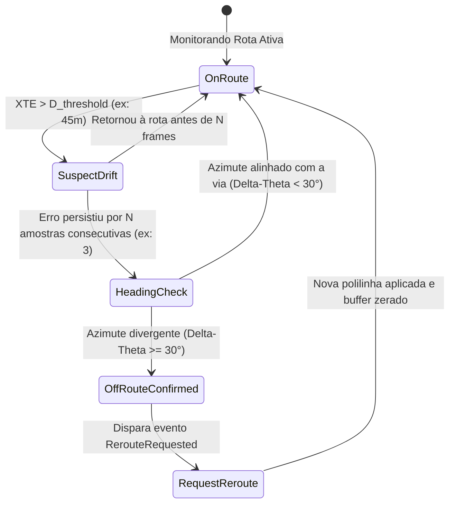
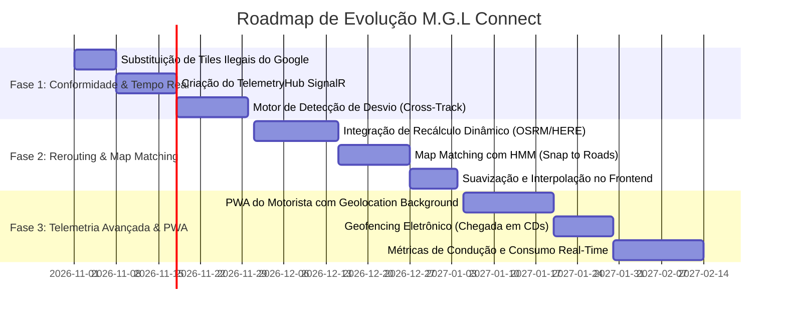

# Relatório Técnico Especializado: Diagnóstico do Projeto, Revisão da Google Maps API, Rastreamento em Tempo Real & Roteamento Dinâmico com Correção de Trajetória

---

## 1. Diagnóstico do Estado Atual do Projeto (M.G.L Connect)

O projeto **M.G.L Connect** é uma solução corporativa de logística integrada (3PL & Cargas Pesadas) desenvolvida em **ASP.NET Core 6 (MVC + REST API)**, com **Entity Framework Core** operando em modelo híbrido (SQLite para desenvolvimento local ágil e PostgreSQL/Npgsql para produção em nuvem), além de **SignalR** para comunicação duplex via WebSockets.

### 1.1. Arquitetura e Recursos Já Implementados
A análise dos arquivos do projeto ([src/MglConnect.Web](file:///home/gabriel/projetos/src/MglConnect.Web)) revela uma base sólida com módulos avançados:

1. **Roteamento de Carga Pesada vs. Leve ([TruckRoutingService.cs](file:///home/gabriel/projetos/src/MglConnect.Web/Services/TruckRoutingService.cs)):**
   - Lógica de bifurcação entre veículo pesado (caminhões/carretas) e leve (vans/utilitários).
   - Verificação de gabarito de altura (ex: viadutos baixos do centro de SP desviados para o Rodoanel Mário Covas SP-021 com vão de 5,50m).
   - Alertas georreferenciados de balanças de pesagem dinâmica PBT (ex: SP-160 km 41), ZMRC (Zona de Máxima Restrição de Circulação) e restrições de produtos perigosos em túneis.
   - Cálculo de pedágios com base na quantidade de eixos do veículo e telemetria financeira de combustível ([FuelCostService.cs](file:///home/gabriel/projetos/src/MglConnect.Web/Services/FuelCostService.cs)).
   - Integração com **OSRM (Open Source Routing Machine)** online com passos *turn-by-turn* (`steps=true`) e malha densa de fallback com 34 coordenadas geodésicas reais de Cajamar até o Porto de Santos.

2. **Cockpit HUD de Bordo Estilo Waze ([Views/Entregas/Navegar.cshtml](file:///home/gabriel/projetos/src/MglConnect.Web/Views/Entregas/Navegar.cshtml)):**
   - Interface imersiva para o motorista com indicação visual de manobras, distância para a próxima conversão, velocímetro dinâmico, estimativa de consumo de diesel e ETA.
   - Suporte à API nativa de geolocalização do dispositivo (`navigator.geolocation.watchPosition`) e modo de simulação assistida ao longo da polilinha.
   - Coleta de assinatura digital biométrica (*Proof of Delivery — POD*) via HTML5 Canvas integrada ao cockpit.

3. **Portal do Cliente e Rastreamento Público Estilo Mercado Livre ([Views/Rastreio/Index.cshtml](file:///home/gabriel/projetos/src/MglConnect.Web/Views/Rastreio/Index.cshtml)):**
   - Stepper visual de progresso da encomenda em 5 etapas.
   - Timeline de eventos em tempo real conectada via SignalR (`JoinTrackingGroup(codigoRastreio)`).

---

### 1.2. Gaps Técnicos e Oportunidades Críticas de Evolução

Apesar do alto nível das funcionalidades já construídas, foram identificadas vulnerabilidades arquiteturais que impedem o funcionamento dinâmico pleno em cenários reais:

| Ponto de Análise | Situação Atual | Impacto Operacional |
| :--- | :--- | :--- |
| **Comunicação em Tempo Real** | O [TrackingHub.cs](file:///home/gabriel/projetos/src/MglConnect.Web/Hubs/TrackingHub.cs) transmite apenas **eventos pontuais de status** (ex: "Saiu para entrega", "Mercadoria conferida"). | Não existe um fluxo de streaming de coordenadas GPS contínuo entre o veículo em campo e o mapa da central de monitoramento. |
| **Recálculo de Rota (Rerouting)** | A polilinha de rota é gerada estaticamente na carga inicial da página via OSRM. Se o caminhoneiro entrar em uma via paralela, o sistema não recalcula a trajetória. | O mapa torna-se obsoleto imediatamente após qualquer conversão não planejada, gerando falhas em ETAs e desorientação do condutor. |
| **Camada de Mapas (Tiles)** | Em [Navegar.cshtml:225](file:///home/gabriel/projetos/src/MglConnect.Web/Views/Entregas/Navegar.cshtml#L225), há uma chamada direta `https://{s}.google.com/vt/lyrs=m...` via Leaflet. | **Violação direta dos Termos de Serviço do Google Maps Platform** (seção 3.2.4: *proibição de tile scraping/reverse engineering*), sujeita a bloqueio de IP e indisponibilidade do mapa sem aviso. |
| **Demarcação da Trilha GPS** | Leitura crua do `pos.coords.latitude/longitude`. | O "GPS Jitter" (ruído natural de 5 a 15 metros) faz o marcador do veículo flutuar lateralmente, atravessar canteiros e quarteirões por falta de *Map Matching*. |

---

## 2. Revisão Aprofundada da API do Google Maps (Google Maps Platform)

A integração do ecossistema Google Maps na logística de carga pesada exige uma avaliação minuciosa de capacidades, restrições contratuais e custos.



### 2.1. Análise Módulo a Módulo

#### 1. Routes API (Sucessora da Directions API)
- **Vantagens:** Tráfego preditivo em tempo real incomparável (alimentado pela base global do Google Maps e Waze), suporte a rotas alternativas e matriz de pedágios integrada (`computeRoutes` com `extraComputations: ["TOLLS"]`).
- **A Restrição do Modo Caminhão (Large Vehicle Routing - LVR):** A Google lançou o parâmetro `travelMode: "TRUCK"` com suporte a altura, largura, peso e cargas perigosas (`hazmat`). No entanto, **o LVR está ativo para os 48 estados dos EUA e em testes no Japão**. No Brasil (especialmente rodovias estaduais paulistas como SP-021, SP-160, SP-330), as restrições físicas de gabarito e pontes ainda não estão consolidadas na base nativa do Google Maps para caminhões de grande porte. Se a sua frota rodar com perfil convencional de carro (`DRIVE`), o Google poderá direcionar carretas de 4,20m de altura para viadutos centrais ou túneis restritos.

#### 2. Google Roads API (`snapToRoads`)
- **Propósito:** Recebe até 100 coordenadas de GPS desordenadas ou ruidosas e retorna a polilinha exata projetada no eixo da pista da via pública.
- **Limitações:** Custo de aproximadamente **US$ 10,00 por 1.000 requisições**. Para uma frota emitindo coordenadas a cada 3 segundos, o custo mensal por caminhão pode se tornar impraticável sem agregação prévia de dados.

#### 3. Termos de Serviço (ToS) e Riscos Legais
- **Artigo 3.2.4 (Restrições de Uso de Conteúdo):** O Google proíbe expressamente:
  - Consumir tiles de satélite ou roadmap diretamente via bibliotecas open-source (`Leaflet`, `OpenLayers`, `MapLibre`) simulando o servidor de mapas.
  - Armazenar em cache permanente polilinhas de rotas (cache permitido apenas por até 30 dias para otimização de performance técnica).
  - Desenvolver aplicativos de navegação assistida passo a passo (*turn-by-turn*) utilizando apenas a Directions API REST comum. Para isso, o Google exige o uso do **Google Navigation SDK**.

---

### 2.2. Matriz Comparativa: Google Maps vs. Alternativas Industriais

| Critério | Google Maps Platform | HERE Technologies (Fleet Telematics) | OSRM / Valhalla (Open Source / OSM) | Mapbox Navigation SDK |
| :--- | :--- | :--- | :--- | :--- |
| **Gabarito de Caminhões no Brasil** | ⚠️ Limitado (LVR restrito aos EUA/JP) | ⭐⭐⭐⭐⭐ **Excelente** (Padrão mundial para caminhões, cobre ZMRC e eixos no Brasil) | ⭐⭐⭐⭐ Muito Bom (Customizável via perfis Lua `truck.lua`) | ⭐⭐⭐ Bom (Via Mapbox Directions com perfis customizados) |
| **Tráfego em Tempo Real** | ⭐⭐⭐⭐⭐ Absoluto (Base do Waze/Android) | ⭐⭐⭐⭐ Muito Robusto | ❌ Não nativo (Requer injeção manual de dados de trânsito) | ⭐⭐⭐⭐ Excelente |
| **Map Matching (Snap to Roads)** | Roads API (US$ 10 / 1k reqs) | Advanced Fleet Route Matching | OSRM Match API / Valhalla Meili (Gratuito) | Mapbox Map Matching API |
| **Custo de Operação** | Elevado (Cobrança em dólar por chamada) | Médio / Corporativo | **Custo Zero de licença** (Apenas infraestrutura Docker) | Médio (Tier gratuito generoso) |
| **Flexibilidade de Rerouting** | Alta via Webhooks e SDKs | Altíssima via REST & SDK | Total via API local de ultra baixa latência (<10ms) | Alta via SDK mobile |

> [!TIP]
> **Recomendação de Arquitetura Híbrida (Smart Stacking):**
> Utilize **OSRM/Valhalla auto-hospedado** ou **HERE Fleet API** para o cálculo restrito de veículos pesados (altura, peso, eixos e ZMRC), e reserve o **Google Maps Platform** para Geocoding (busca de endereços precisos) e renderização visual oficial no portal web quando o cliente corporativo exigir a identidade visual Google.

---

## 3. Engenharia de Tempo Real: Detecção de Desvio e Recálculo Automático

O maior desafio prático em plataformas de telemetria logística é saber **quando** o caminhão realmente desviou da rota planejada e **quando** é apenas uma oscilação momentânea de satélite.

### 3.1. Fundamentação Matemática do Desvio de Rota

A rota planejada é composta por uma cadeia ordenada de segmentos $S_i = (P_i, P_{i+1})$. A cada instante $t$, o dispositivo móvel do motorista emite sua posição $P_{atual} = (\text{lat}_c, \text{lng}_c)$, velocidade $v$ e azimute de deslocamento $\theta_{atual}$ (*bearing*).



#### 1. Cross-Track Error / Distance (XTE / XTD)
Representa a menor distância ortogonal entre a posição atual do caminhão e a linha que une os dois waypoints da rota:

$$d_{xt} = \arcsin\left(\sin\left(\frac{d_{AP}}{R}\right) \cdot \sin(\theta_{AP} - \theta_{AB})\right) \cdot R$$

Onde:
- $d_{AP}$ é a distância geodésica (Haversine) do início do segmento $A$ até a posição atual $P$.
- $\theta_{AP}$ é o azimute geodésico do ponto $A$ até o ponto $P$.
- $\theta_{AB}$ é o azimute geodésico do traçado da rodovia (segmento de $A$ a $B$).
- $R$ é o raio esférico da Terra ($6.371.000\text{ m}$).

#### 2. Along-Track Distance (ATD)
Mede o progresso ao longo do segmento ativo para saber se o veículo avançou para o próximo trecho:

$$d_{at} = \arccos\left(\frac{\cos(d_{AP}/R)}{\cos(d_{xt}/R)}\right) \cdot R$$

- Se $d_{at} > \text{comprimento}(AB)$, o veículo já superou o segmento atual; avança-se o índice da rota para $S_{i+1}$.
- Se $d_{at} < 0$, o caminhão ainda está antes do início do segmento.

---

### 3.2. Mecanismo de Histerese Espaço-Temporal (Antirruído)

Em ambientes reais, disparar o recálculo imediato na primeira coordenada fora da rota causa o chamado **"Efeito Reroute Frenético"** (quando o caminhão para em um posto de gasolina, passa por um túnel ou troca de pista e o sistema faz 10 requisições seguidas).

Para eliminar falsos positivos, implementa-se um filtro com 3 critérios concorrentes:



1. **Limiar Espacial ($D_{threshold}$):**  
   - Trecho Urbano: $35\text{ metros}$ (largura de avenidas e vias marginais).  
   - Rodovias / Autoestradas: $60\text{ a }80\text{ metros}$ (considerando alças de acesso e acostamentos).
2. **Janela Temporal de Persistência ($N$ frames):**  
   O veículo deve permanecer a uma distância $> D_{threshold}$ durante **pelo menos 3 a 5 transmissões consecutivas de telemetria** (ou 8 a 10 segundos ininterruptos).
3. **Validação Vetorial por Azimute ($\Delta\theta$):**  
   Se o desvio angular $|\theta_{atual} - \theta_{rota}| > 45^\circ$, o caminhão manobrou efetivamente para outra via; se o azimute continua paralelo, o veículo está apenas transitando por uma pista marginal da mesma rodovia.

---

## 4. Correção e Demarcação Cartográfica: Map Matching & Suavização

A demarcação de rotas em tempo real sofre com dois problemas clássicos em campo:
1. **Traçado "Serrote" (Multipath GPS Drift):** Em áreas com prédios altos ou vales de serras (ex: descida da Serra do Mar na Rodovia dos Imigrantes), o sinal do satélite reflete em estruturas e projeta o caminhão centenas de metros fora da pista.
2. **Movimentação "Teletransportada":** O marcador do veículo pula bruscamente no mapa a cada nova coordenada recebida.

### 4.1. Algoritmo de Map Matching (Hidden Markov Models - HMM)

O *Map Matching* converte uma sequência de coordenadas ruidosas na sequência mais provável de arcos na malha viária real:

```mermaid
flowchart TD
    subgraph ObservacoesGPS["Pontos de GPS Observados (com ruído)"]
        Z1["GPS Ponto z1"]
        Z2["GPS Ponto z2"]
        Z3["GPS Ponto z3"]
    end

    subgraph CandidatosVias["Segmentos de Rodovia Candidatos"]
        R1a["Via A (Anhanguera)"]
        R1b["Via B (Marginal)"]
        R2a["Via A"]
        R2b["Via B"]
        R3a["Via A"]
    end

    Z1 -. Probabilidade de Emissão .-> R1a
    Z1 -.-> R1b
    Z2 -.-> R2a
    Z2 -.-> R2b
    Z3 -.-> R3a

    R1a == Probabilidade de Transição == R2a
    R2a == Algoritmo de Viterbi == R3a

    classDef best fill:#5BC0BE,stroke:#0B132B,stroke-width:2px,color:#0B132B;
    class R1a,R2a,R3a best;
```

- **Probabilidade de Emissão:** Modela a distância euclidiana do ponto GPS até a via candidata através de uma distribuição normal Gaussiana:
  $$p(z_t | r_i) = \frac{1}{\sqrt{2\pi}\sigma_z} \exp\left(-\frac{\text{dist}(z_t, r_i)^2}{2\sigma_z^2}\right)$$
- **Probabilidade de Transição:** Avalia a plausibilidade de o caminhão ter percorrido a distância na rede entre duas vias candidatas em relação à distância direta em linha reta. Se a distância pela via for compatível com a velocidade máxima do veículo, a transição é aceita.
- **Resolução via Viterbi:** O algoritmo encontra o caminho globalmente ótimo na malha, eliminando saltos impossíveis.

---

### 4.2. Suavização Visual no Frontend (Interpolação e Rotação Suave)

Para que a experiência do operador na central e do cliente no portal de rastreamento seja equivalente à de grandes aplicativos (Uber, Mercado Livre), aplicam-se duas técnicas no cliente:

1. **Interpolação Linear / Cúbica do Marcador:**  
   Em vez de executar `marker.setLatLng([newLat, newLng])`, utiliza-se uma animação por frames (`requestAnimationFrame`) que desloca o ícone suavemente durante o intervalo entre duas leituras (ex: 2 segundos).
2. **Rotação Dinâmica com Slerp (Spherical Linear Interpolation):**  
   O ângulo do ícone do caminhão é interpolado para evitar giros de 180° instantâneos quando o GPS oscila.
3. **Substituição Visual da Polilinha (Cross-Fade):**  
   Quando o desvio é confirmado e uma nova rota é retornada pelo servidor, a rota antiga passa para opacidade reduzida (cinza translúcido) e a nova rota é desenhada progressivamente do ponto atual do veículo até o destino final.

---

## 5. Implementação Técnica Proposta para o M.G.L Connect

Abaixo são apresentados os dois componentes técnicos prontos para integrar o ecossistema do M.G.L Connect: o serviço backend de detecção/recálculo e o módulo frontend de telemetria contínua.

### 5.1. Backend C#: Serviço de Detecção de Desvio e Recálculo Dinâmico

```csharp
namespace MglConnect.Web.Services
{
    public class RouteDeviationEngine
    {
        private const double EarthRadiusMeters = 6371000.0;
        private const double DeviationThresholdMeters = 50.0; // 50 metros de tolerância
        private const int ConsecutiveFramesThreshold = 3;     // 3 pacotes persistentes

        public class TelemetryState
        {
            public int EntregaId { get; set; }
            public int ActiveSegmentIndex { get; set; }
            public int OffRouteFramesCount { get; set; }
            public bool IsOffRoute { get; set; }
            public double LastKnownLatitude { get; set; }
            public double LastKnownLongitude { get; set; }
            public double LastHeading { get; set; }
        }

        public (bool needsReroute, int updatedSegmentIndex) EvaluatePosition(
            TelemetryState state, 
            double currentLat, 
            double currentLng, 
            double? currentBearing, 
            List<RouteCoordinate> routeCoordinates)
        {
            if (routeCoordinates == null || routeCoordinates.Count < 2)
                return (false, 0);

            // 1. Encontrar o segmento da rota mais próximo da coordenada atual
            double minCrossTrack = double.MaxValue;
            int bestSegmentIndex = state.ActiveSegmentIndex;

            // Busca local em torno do segmento ativo para otimização de performance O(k)
            int searchStart = Math.Max(0, state.ActiveSegmentIndex - 1);
            int searchEnd = Math.Min(routeCoordinates.Count - 2, state.ActiveSegmentIndex + 5);

            for (int i = searchStart; i <= searchEnd; i++)
            {
                var p1 = routeCoordinates[i];
                var p2 = routeCoordinates[i + 1];

                double xtd = CalculateCrossTrackDistance(
                    p1.Latitude, p1.Longitude, 
                    p2.Latitude, p2.Longitude, 
                    currentLat, currentLng);

                double atd = CalculateAlongTrackDistance(
                    p1.Latitude, p1.Longitude, 
                    p2.Latitude, p2.Longitude, 
                    currentLat, currentLng);

                double segmentLength = HaversineDistanceMeters(p1.Latitude, p1.Longitude, p2.Latitude, p2.Longitude);

                // Se a projeção cai dentro do segmento ou logo à frente
                if (atd >= 0 && atd <= segmentLength)
                {
                    if (Math.Abs(xtd) < Math.Abs(minCrossTrack))
                    {
                        minCrossTrack = Math.Abs(xtd);
                        bestSegmentIndex = i;
                    }
                }
            }

            // Atualiza o segmento ativo do caminhão
            state.ActiveSegmentIndex = bestSegmentIndex;

            // 2. Avaliação de Histerese de Desvio
            if (minCrossTrack > DeviationThresholdMeters)
            {
                state.OffRouteFramesCount++;
            }
            else
            {
                state.OffRouteFramesCount = 0;
                state.IsOffRoute = false;
                return (false, bestSegmentIndex);
            }

            // 3. Gatilho de confirmação de Rerouting
            if (state.OffRouteFramesCount >= ConsecutiveFramesThreshold)
            {
                state.IsOffRoute = true;
                return (true, bestSegmentIndex);
            }

            return (false, bestSegmentIndex);
        }

        private static double CalculateCrossTrackDistance(double lat1, double lon1, double lat2, double lon2, double lat3, double lon3)
        {
            double d13 = HaversineDistanceMeters(lat1, lon1, lat3, lon3) / EarthRadiusMeters;
            double theta13 = ToRadians(CalculateBearing(lat1, lon1, lat3, lon3));
            double theta12 = ToRadians(CalculateBearing(lat1, lon1, lat2, lon2));

            double dXt = Math.Asin(Math.Sin(d13) * Math.Sin(theta13 - theta12)) * EarthRadiusMeters;
            return dXt;
        }

        private static double CalculateAlongTrackDistance(double lat1, double lon1, double lat2, double lon2, double lat3, double lon3)
        {
            double d13 = HaversineDistanceMeters(lat1, lon1, lat3, lon3) / EarthRadiusMeters;
            double dXt = CalculateCrossTrackDistance(lat1, lon1, lat2, lon2, lat3, lon3) / EarthRadiusMeters;

            double dAt = Math.Acos(Math.Cos(d13) / Math.Cos(dXt)) * EarthRadiusMeters;
            return double.IsNaN(dAt) ? 0.0 : dAt;
        }

        private static double HaversineDistanceMeters(double lat1, double lon1, double lat2, double lon2)
        {
            double dLat = ToRadians(lat2 - lat1);
            double dLon = ToRadians(lon2 - lon1);
            double a = Math.Sin(dLat / 2) * Math.Sin(dLat / 2) +
                       Math.Cos(ToRadians(lat1)) * Math.Cos(ToRadians(lat2)) *
                       Math.Sin(dLon / 2) * Math.Sin(dLon / 2);
            double c = 2 * Math.Atan2(Math.Sqrt(a), Math.Sqrt(1 - a));
            return EarthRadiusMeters * c;
        }

        private static double CalculateBearing(double lat1, double lon1, double lat2, double lon2)
        {
            double y = Math.Sin(ToRadians(lon2 - lon1)) * Math.Cos(ToRadians(lat2));
            double x = Math.Cos(ToRadians(lat1)) * Math.Sin(ToRadians(lat2)) -
                       Math.Sin(ToRadians(lat1)) * Math.Cos(ToRadians(lat2)) * Math.Cos(ToRadians(lon2 - lon1));
            return (ToDegrees(Math.Atan2(y, x)) + 360.0) % 360.0;
        }

        private static double ToRadians(double degrees) => degrees * Math.PI / 180.0;
        private static double ToDegrees(double radians) => radians * 180.0 / Math.PI;
    }
}
```

---

### 5.2. Hub SignalR de Telemetria Contínua (`TelemetryHub.cs`)

Para suportar posições em tempo real sem sobrecarregar o banco de dados relacional:

```csharp
using Microsoft.AspNetCore.SignalR;
using System.Threading.Tasks;

namespace MglConnect.Web.Hubs
{
    public class TelemetryHub : Hub
    {
        // Motorista transmite posição contínua (ex: a cada 2 segundos)
        public async Task SendVehicleTelemetry(
            string codigoRastreio, 
            double latitude, 
            double longitude, 
            double speedKmH, 
            double heading)
        {
            var payload = new
            {
                codigoRastreio,
                latitude,
                longitude,
                speedKmH,
                heading,
                timestamp = System.DateTime.UtcNow
            };

            // Notifica o grupo específico daquela entrega (Central de Operações e Cliente)
            await Clients.Group(codigoRastreio).SendAsync("ReceiveVehiclePosition", payload);
        }

        public async Task JoinLiveTracking(string codigoRastreio)
        {
            await Groups.AddToGroupAsync(Context.ConnectionId, codigoRastreio);
        }
    }
}
```

---

### 5.3. Frontend: Controlador de Rastreamento com Suavização e Auto-Reroute

Integração limpa para atualizar o mapa em tempo real via Leaflet/Google Maps API:

```javascript
// Gerenciador de Telemetria e Suavização de Rota M.G.L Connect
class MglLiveTracker {
    constructor(map, initialCoordinates, codigoRastreio) {
        this.map = map;
        this.currentRoute = initialCoordinates; // Array de [lat, lng]
        this.codigoRastreio = codigoRastreio;
        this.routePolyline = null;
        this.vehicleMarker = null;
        this.targetLatLng = null;
        this.currentLatLng = null;
        this.animFrameId = null;
        this.isRerouting = false;

        this.initLayers();
        this.initSignalR();
    }

    initLayers() {
        // Traçado base em Teal corporativo MGL
        this.routePolyline = L.polyline(this.currentRoute, {
            color: '#5BC0BE',
            weight: 6,
            opacity: 0.95,
            smoothFactor: 1.0
        }).addTo(this.map);

        // Marcador do caminhão com SVG customizado
        const truckIcon = L.divIcon({
            html: `
                <div id="truckMarkerIcon" style="
                    width: 42px; height: 42px; 
                    background: #0B132B; 
                    border: 3px solid #5BC0BE; 
                    border-radius: 50%; 
                    display: flex; align-items: center; justify-content: center;
                    box-shadow: 0 4px 15px rgba(0,0,0,0.5);
                    transition: transform 0.4s ease-out;">
                    <i class="bi bi-truck-front-fill" style="color: #5BC0BE; font-size: 1.4rem;"></i>
                </div>`,
            className: 'custom-truck-marker',
            iconSize: [42, 42],
            iconAnchor: [21, 21]
        });

        const startPoint = this.currentRoute[0] || [-23.3557, -46.8776];
        this.currentLatLng = L.latLng(startPoint[0], startPoint[1]);
        this.vehicleMarker = L.marker(this.currentLatLng, { icon: truckIcon }).addTo(this.map);
    }

    initSignalR() {
        const connection = new signalR.HubConnectionBuilder()
            .withUrl("/telemetryHub")
            .withAutomaticReconnect()
            .build();

        connection.on("ReceiveVehiclePosition", (data) => {
            this.onTelemetryUpdate(data);
        });

        connection.on("ReceiveRouteRecalculated", (newRouteCoords) => {
            this.applyNewRoute(newRouteCoords);
        });

        connection.start().then(() => {
            connection.invoke("JoinLiveTracking", this.codigoRastreio);
            console.log("Conectado ao TelemetryHub para:", this.codigoRastreio);
        });
    }

    onTelemetryUpdate(data) {
        this.targetLatLng = L.latLng(data.latitude, data.longitude);
        
        // Rotação dinâmica do ícone do caminhão
        if (data.heading !== undefined) {
            const iconElem = document.getElementById("truckMarkerIcon");
            if (iconElem) {
                iconElem.style.transform = `rotate(${data.heading}deg)`;
            }
        }

        // Inicia interpolação suave entre pontos (evita saltos)
        this.animateMarkerMovement();
    }

    animateMarkerMovement() {
        if (!this.targetLatLng) return;

        const duration = 1800; // 1.8 segundos de transição
        const startTime = performance.now();
        const startPos = this.currentLatLng;
        const endPos = this.targetLatLng;

        const step = (now) => {
            const progress = Math.min(1, (now - startTime) / duration);
            const curLat = startPos.lat + (endPos.lat - startPos.lat) * progress;
            const curLng = startPos.lng + (endPos.lng - startPos.lng) * progress;

            this.currentLatLng = L.latLng(curLat, curLng);
            this.vehicleMarker.setLatLng(this.currentLatLng);

            if (progress < 1) {
                this.animFrameId = requestAnimationFrame(step);
            }
        };

        if (this.animFrameId) cancelAnimationFrame(this.animFrameId);
        this.animFrameId = requestAnimationFrame(step);
    }

    applyNewRoute(newCoordinates) {
        // Efeito de transição de rota (Cross-Fade)
        const oldPolyline = this.routePolyline;
        oldPolyline.setStyle({ color: '#94A3B8', dashArray: '6, 8', opacity: 0.5 });

        this.routePolyline = L.polyline(newCoordinates, {
            color: '#5BC0BE',
            weight: 6,
            opacity: 0
        }).addTo(this.map);

        // Animação de fade-in da nova rota recalculada
        let op = 0;
        const fadeIn = setInterval(() => {
            op += 0.1;
            this.routePolyline.setStyle({ opacity: op });
            if (op >= 1) {
                clearInterval(fadeIn);
                this.map.removeLayer(oldPolyline);
            }
        }, 40);

        this.currentRoute = newCoordinates;
    }
}
```

---

## 6. Roadmap de Implementação e Evolução do Projeto

Para levar o M.G.L Connect ao nível de produção industrial escalável, o seguinte cronograma em 3 etapas é indicado:



### Síntese das Fases:
1. **Fase 1 (Imediata — Conformidade & Fundação Real-Time):**
   - Corrigir a chamada de tiles do Google Maps em [Navegar.cshtml](file:///home/gabriel/projetos/src/MglConnect.Web/Views/Entregas/Navegar.cshtml), migrando para camadas oficiais (OpenStreetMap, CartoDB Positron/Dark Matter ou Google Maps JavaScript SDK licenciado).
   - Expandir o SignalR com o `TelemetryHub` para transmitir coordenadas de forma leve.
2. **Fase 2 (Curto Prazo — Inteligência de Rota & Rerouting):**
   - Incorporar o `RouteDeviationEngine` no backend. Quando o desvio for verificado por mais de 3 leituras consecutivas, o backend solicita uma nova rota ao `TruckRoutingService` e publica a nova polilinha para a central e o cliente.
   - Implementar o *Map Matching* no pipeline de coordenadas para garantir que o traçado fique perfeitamente acoplado às vias rodoviárias (sem "cortar quarteirões").
3. **Fase 3 (Médio Prazo — Solução de Campo Completa):**
   - Transformar a view de navegação em um **PWA (Progressive Web App)** instalável no smartphone do motorista, capaz de coletar GPS em background e funcionar com sincronização offline em áreas sem sinal de internet (como trechos da Serra do Mar).
   - Implementação de **Geofencing (Cercas Virtuais)** automáticas para registrar entrada e saída dos Centros de Distribuição sem necessidade de intervenção humana.
